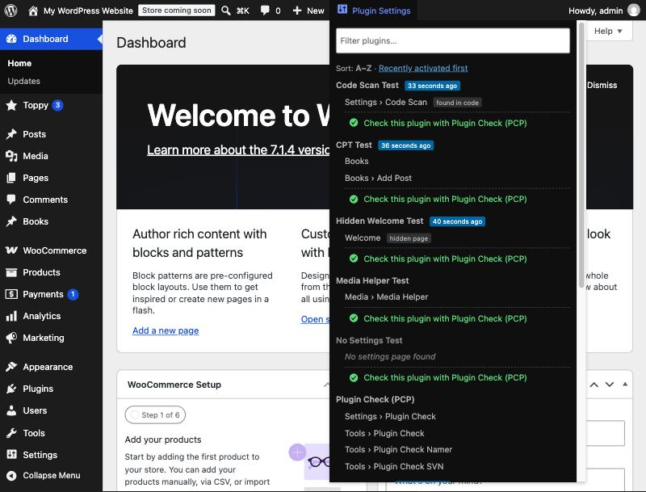

# Plugin Settings Finder

**Stop hunting for plugin settings pages.** An admin bar dropdown that lists every active WordPress plugin with direct links to its settings, wherever the plugin decided to put them.



## The problem

When you review or test a plugin, you install it, activate it, and then go looking for its settings. There is no rule for where they end up:

- its own top-level menu item, near the top or at the very bottom
- under **Tools**
- under **Settings**
- under **Users** or the profile screen, if it is about user profiles
- under **Media**, if it handles media
- under **WooCommerce** or **Products**, for WooCommerce extensions
- as a new tab in the WooCommerce settings tab bar, or a section inside one (payment gateway, shipping method, integration, email)
- on a hidden page with no menu item at all, like a setup wizard

Plugin Settings Finder solves that. Open the **Plugin Settings** dropdown and every active plugin is listed with its pages and a breadcrumb showing where each one lives, for example `Settings › Clario` or `WooCommerce › Settings › Payments › Foo Pay`. If a plugin has no admin screen, it says **No settings page found**.

## Features

- **Every location covered:** top-level menus, submenus anywhere, hidden pages, post type and taxonomy screens, WooCommerce settings tabs and sections, payment gateways, shipping methods, integrations and emails.
- **Plugin Check (PCP) shortcut:** when [Plugin Check](https://wordpress.org/plugins/plugin-check/) is active, every plugin gets a highlighted *Check this plugin with Plugin Check (PCP)* link that opens PCP with that plugin preselected.
- **Sort switch:** A to Z (default) or recently activated first, saved per user. Recently activated plugins get a "x minutes ago" badge.
- **Filter field** to narrow the list by plugin name or page.
- **One click to settings:** clicking a plugin name opens the page that looks most like its settings.
- **Less noise:** Elementor, WooCommerce and Contact Form 7 are hidden by default, because they are installed almost everywhere. Their extensions are still listed.
- Works on the front end too, using the list from the last admin screen.
- Nothing leaves your site. No settings screen, no external requests.

## How it finds pages

It does not guess from plugin names. Each page is attributed by asking PHP where the code behind it lives:

| Source | How it is attributed |
| --- | --- |
| Admin menu and submenu pages | File of the page callback (via Reflection) |
| Hidden pages (wizards, welcome screens) | Same, for pages registered without a visible parent |
| Post type and taxonomy screens | The plugin file that called `register_post_type()` / `register_taxonomy()` |
| WooCommerce tabs, sections, gateways, shipping methods, integrations, emails | The concrete class file, so an add-on extending `WC_Settings_Page` counts as the add-on, not WooCommerce |
| Plugins screen row links ("Settings") | The plugin's own `plugin_action_links` filters |
| Fallback | The plugin's PHP files are scanned for slugs passed to `add_*_page()` and matched against pages that are actually registered (marked *found in code*) |

The list is rebuilt on admin screens whenever the set of active plugins changes, every ten minutes, or when you click **Rescan now**.

## Installation

**As a normal plugin:** download the repository as a ZIP, upload it under *Plugins › Add New › Upload Plugin* and activate it. Or clone it into `wp-content/plugins/plugin-settings-finder`.

**As a must-use plugin** (always on, handy on review sites): copy the `plugin-settings-finder` folder into `wp-content/mu-plugins/` and copy `extras/mu-loader.php` next to it. WordPress only loads PHP files at the top level of `mu-plugins`, so the folder alone does nothing.

```
wp-content/mu-plugins/
├── mu-loader.php
└── plugin-settings-finder/
```

Requires WordPress 6.0+ and PHP 7.4+.

## Filters

```php
// Hide more always-installed plugins (folder names).
add_filter( 'psf_hidden_plugins', function ( $hidden ) {
	$hidden[] = 'elementor-pro';
	return $hidden;
} );

// Show everything, nothing hidden.
add_filter( 'psf_hidden_plugins', '__return_empty_array' );

// Who sees the dropdown (default: activate_plugins).
add_filter( 'psf_capability', function () {
	return 'manage_options';
} );
```

## License

GPLv2 or later. See [LICENSE](LICENSE).
