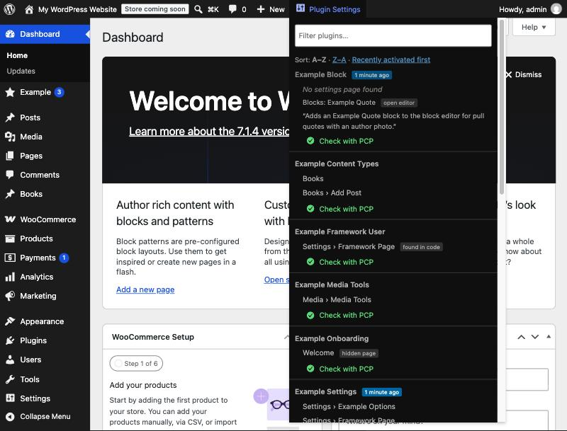

# Plugin Settings Finder

**Stop hunting for plugin settings pages.** An admin bar dropdown that lists every active WordPress plugin with direct links to its settings, wherever the plugin decided to put them.



## The problem

When you review or test a plugin, you install it, activate it, and then go looking for its settings. There is no rule for where they end up:

- its own top-level menu item, near the top or at the very bottom
- under **Tools**
- under **Settings**
- under **Users** or the profile screen, if it is about user profiles
- under **Media**, if it handles media
- under **WooCommerce** or **Products**, for WooCommerce extensions
- as a new tab in the WooCommerce settings tab bar, or a section inside one (payment gateway, shipping method, integration, email)
- on a hidden page with no menu item at all, like a setup wizard

Plugin Settings Finder solves that. Open the **Plugin Settings Finder** dropdown and every active plugin is listed with its pages and a breadcrumb showing where each one lives, for example `Settings › Example` or `WooCommerce › Settings › Payments › Example Pay`. If a plugin has no admin screen, it says **No settings page found** and shows what it adds instead: blocks, shortcodes, widgets, hints from its readme and the readme's short description. So you know whether to look in the block editor, a shortcode, a widget area, or nowhere at all.

## Features

- **Every location covered:** top-level menus, submenus anywhere, hidden pages, post type and taxonomy screens, WooCommerce settings tabs and sections, payment gateways, shipping methods, integrations and emails.
- **No settings page? Find out why:** blocks (from `block.json` and `register_block_type()`), shortcodes and widgets registered by the plugin, plus readme hints such as *works without configuration*.
- **Plugin Check (PCP) shortcut:** when [Plugin Check](https://wordpress.org/plugins/plugin-check/) is active, every plugin gets a highlighted *Check with PCP* link that opens PCP with that plugin preselected.
- **Sort switch:** A to Z (default), Z to A, or recently activated first, saved per user. Each plugin is its own segment, separated by a line. Recently activated plugins get a "x minutes ago" badge.
- **Filter field** to narrow the list by plugin name or page.
- **One click to settings:** clicking a plugin name opens the page that looks most like its settings.
- **Less noise:** Elementor, WooCommerce and Contact Form 7 are hidden by default, because they are installed almost everywhere. Their extensions are still listed.
- **WP-CLI:** `wp settings-finder list | rescan | install-mu`, including a one-command move into `mu-plugins`.
- Works on the front end too, using the list from the last admin screen.
- Nothing leaves your site. No settings screen, no external requests.

## How it finds pages

It does not guess from plugin names. Each page is attributed by asking PHP where the code behind it lives:

| Source | How it is attributed |
| --- | --- |
| Admin menu and submenu pages | File of the page callback (via Reflection) |
| Hidden pages (wizards, welcome screens) | Same, for pages registered without a visible parent |
| Post type and taxonomy screens | The plugin file that called `register_post_type()` / `register_taxonomy()` |
| WooCommerce tabs, sections, gateways, shipping methods, integrations, emails | The concrete class file, so an add-on extending `WC_Settings_Page` counts as the add-on, not WooCommerce |
| Plugins screen row links ("Settings") | The plugin's own `plugin_action_links` filters |
| Fallback | The plugin's PHP files are scanned for slugs passed to `add_*_page()` and matched against pages that are actually registered (marked *found in code*) |

The list is rebuilt on admin screens whenever the set of active plugins changes, every ten minutes, or when you click **Rescan now**.

## Installation

Requires WordPress 6.0+ and PHP 7.4+. Pick one of the three ways below.

### Option A: as a normal plugin (quickest)

1. Download **`plugin-settings-finder.zip`** from the [latest release](https://github.com/marceltannich/plugin-settings-finder/releases/latest).
2. In wp-admin go to *Plugins › Add New Plugin › Upload Plugin*, choose the ZIP, click *Install Now*, then *Activate*.
3. Open any admin screen. The **Plugin Settings Finder** dropdown appears in the admin bar.

Or with WP-CLI:

```bash
wp plugin install https://github.com/marceltannich/plugin-settings-finder/releases/latest/download/plugin-settings-finder.zip --activate
```

> Use the release ZIP, not GitHub's green *Code › Download ZIP* button. That one unpacks to a folder called `plugin-settings-finder-main`, which works but looks odd and does not update cleanly.

### Option B: as a must-use plugin (recommended for review and test sites)

A must-use plugin is always on, cannot be deactivated by accident, and keeps working while you activate and deactivate the plugins you are reviewing.

**With WP-CLI**, after Option A:

```bash
wp settings-finder install-mu
wp plugin delete plugin-settings-finder
```

`install-mu` copies the plugin to `wp-content/mu-plugins/plugin-settings-finder/`, writes the loader file `wp-content/mu-plugins/plugin-settings-finder-loader.php` and deactivates the regular copy.

**By hand:**

1. Unzip the release and copy the `plugin-settings-finder` folder into `wp-content/mu-plugins/` (create the folder if it does not exist).
2. Copy `plugin-settings-finder/extras/mu-loader.php` to `wp-content/mu-plugins/plugin-settings-finder-loader.php`.

WordPress only loads PHP files that sit directly in `mu-plugins`, never files inside sub-folders. Without the loader file nothing happens. The result must look like this:

```
wp-content/mu-plugins/
├── plugin-settings-finder-loader.php
└── plugin-settings-finder/
    ├── plugin-settings-finder.php
    ├── includes/
    └── ...
```

Check it under *Plugins › Must-Use*: "Plugin Settings Finder (MU loader)" should be listed.

### Option C: with Git (to pull updates)

```bash
cd wp-content/plugins            # or wp-content/mu-plugins, plus the loader from Option B
git clone https://github.com/marceltannich/plugin-settings-finder.git
wp plugin activate plugin-settings-finder   # skip for mu-plugins
```

Update later with `git pull` in that folder.

### Updating and removing

* **Update:** install the new release ZIP over the old one (*Upload Plugin* offers *Replace current with uploaded*), `git pull`, or for mu-plugins replace the folder.
* **Remove (normal plugin):** deactivate and delete it under *Plugins*. Its stored data (the page index, activation times, sort choice) is removed too.
* **Remove (mu-plugins):** delete `plugin-settings-finder-loader.php` and the `plugin-settings-finder` folder from `mu-plugins`. Leftover data is three small options named `psf_*`; remove them with `wp option delete psf_index psf_activations psf_code_cache psf_usage_cache` if you like.

If both a normal and a must-use copy are present, only the first one loaded (the must-use copy) runs; the other is skipped without errors.

## Usage

Hover **Plugin Settings Finder** in the admin bar:

* Every active plugin is one segment with its admin pages. Click a page to open it; click the plugin name to open the page that looks most like its settings.
* **No settings page found** is followed by what the plugin adds instead (blocks, shortcodes, widgets, readme hints).
* **Check with PCP** opens [Plugin Check](https://wordpress.org/plugins/plugin-check/) with that plugin preselected (only when Plugin Check is active).
* **Sort:** A–Z, Z–A or recently activated first. Saved per user.
* **Filter** field: type part of a plugin or page name.
* **Rescan now** at the bottom rebuilds the list. It is also rebuilt automatically when plugins are activated, deactivated or updated, and every ten minutes.

Elementor, WooCommerce and Contact Form 7 are hidden by default (see Filters).

## WP-CLI

```bash
wp settings-finder rescan                 # rebuild the index now
wp settings-finder list                   # all plugins and their pages
wp settings-finder list akismet           # one plugin (folder name or basename)
wp settings-finder list --empty           # only plugins without a settings page
wp settings-finder list --format=json     # table, csv, json or yaml
wp settings-finder install-mu             # move into mu-plugins (see Option B)
```

`rescan` needs wp-admin, which only exists in a browser request, so it loads one wp-admin page of your own site (a loopback request) as an administrator, with a login session that is created for that one request and destroyed right after. Pick the user with `--user=<login>`. If your site cannot reach itself (local DNS, firewall, HTTP basic auth), it says so; then open any wp-admin page in the browser once, or use `rescan --clear-only`.

## Filters

```php
// Hide more always-installed plugins (folder names).
add_filter( 'psf_hidden_plugins', function ( $hidden ) {
	$hidden[] = 'elementor-pro';
	return $hidden;
} );

// Show everything, nothing hidden.
add_filter( 'psf_hidden_plugins', '__return_empty_array' );

// Who sees the dropdown (default: activate_plugins).
add_filter( 'psf_capability', function () {
	return 'manage_options';
} );
```

## License

GPLv2 or later. See [LICENSE](LICENSE).
